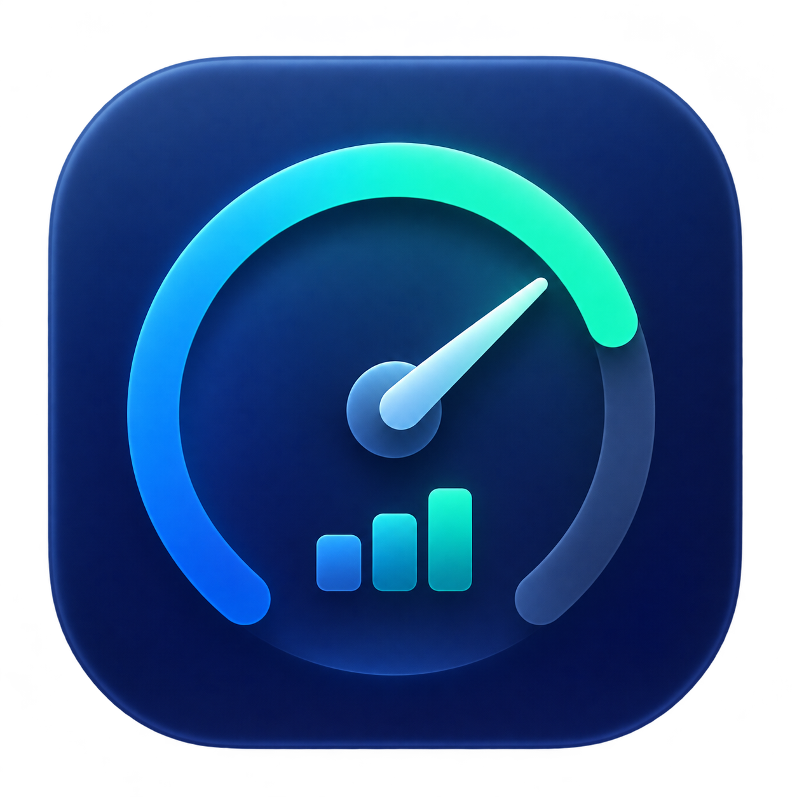

# Subscription Meter

English · [简体中文](README.md)

Subscription Meter is a native macOS menu bar app for viewing AI subscription usage and prepaid balances in one place. Its menu bar item rotates through provider icons and usage rings; click it for details, refresh, and settings. The app interface is currently in Chinese.



UI screenshots are not yet available.

## Supported services

| Service | Displays | Setup and limitations |
| --- | --- | --- |
| GitHub Copilot | Monthly premium requests or credits | Install [GitHub CLI](https://cli.github.com/) and run `gh auth login`. Uses a private Copilot endpoint. |
| ChatGPT / Codex | Rate-limit windows and reset times returned by Codex | Install [Codex CLI](https://github.com/openai/codex) and run `codex login`. This does not cover every ChatGPT feature. |
| Anthropic / Claude | Five-hour and weekly usage windows | Install and sign in to [Claude Code](https://docs.anthropic.com/en/docs/claude-code/overview), then enable it in settings. Uses a private endpoint; not yet tested end to end with a live Claude subscription. |
| DeepSeek | API prepaid balances and currency details | Set `DEEPSEEK_API_KEY` in `~/.env`; queries the official balance endpoint. |
| SiliconFlow | Mainland China site's cash balance, excluding vouchers | Open the login window in settings, sign in and visit the billing balance page. Depends on an internal endpoint and page structure. |

Disable unwanted providers under 设置 → 服务 (Settings → Services). Availability depends on account and plan; private APIs and websites can change.

## Download

Download a stable release or nightly prerelease from [GitHub Releases](https://github.com/greatbody/subscription-meter/releases), extract `Subscription-Meter-macOS-universal.zip`, and move the app to `~/Applications` before opening it. The universal app supports Intel and Apple Silicon on macOS 13 or later. It is ad-hoc signed and not notarized; macOS may require you to allow it in System Settings. To verify the ZIP, run `shasum -a 256 -c SHA256SUMS.txt` in the download directory.

GitHub Actions builds the default branch daily at 19:23 UTC and can also be run manually. Each run creates a separate prerelease; nightly builds may contain unstable changes.

Push a version tag such as `v1.0.0` to trigger the Release workflow. It runs the tests, builds the universal app, generates release notes since the previous stable release, and publishes the release with a checksum file. The first release has no previous stable release to compare against.

## Build from source

Requires macOS 13 or later, an Apple toolchain supporting Swift 5.9, `sips`, `iconutil`, and `codesign`. The universal build targets Intel and Apple Silicon. It has been verified on an Intel Mac with Xcode 26.5 / Swift 6.3.2; a standalone Command Line Tools installation has not been verified. Node.js is needed for the JavaScript test.

Clone the repository, then enter the project directory:

```sh
git clone https://github.com/greatbody/subscription-meter.git
cd subscription-meter
scripts/build-app.sh
open 'build/Subscription Meter.app'
```

The script creates `build/Subscription Meter.app` with an ad-hoc signature; it is not notarized, so macOS may ask you to allow it in System Settings on first launch. Settings appear on first launch; subsequently click the menu bar item to open the panel and settings.

For a fixed installation, quit the app from its menu, then copy the built app to `~/Applications`. Back up or move any existing app with the same name first. Rebuilding does not update an installed copy automatically. Enable 登录时启动 (launch at login) in the app's settings after choosing a stable location; approve it in macOS Login Items if requested.

## Connections and privacy

Enable the providers you need under 设置 → 服务 (Settings → Services). DeepSeek reads this variable from `~/.env` in your home directory without executing the file; use your own key and never commit it:

```dotenv
DEEPSEEK_API_KEY=your_api_key_here
```

- Copilot invokes local `gh` to call GitHub; Codex invokes local `codex app-server` for account rate limits.
- Claude reads Claude Code credentials from Keychain or `~/.claude/.credentials.json` and requests Anthropic's usage endpoint. Keychain may ask for permission.
- The DeepSeek key is sent only to `https://api.deepseek.com/user/balance`; redirects are rejected.
- SiliconFlow uses the app's own persistent WebKit session for `siliconflow.cn`; it does not read other browsers' cookies. Its balance feature depends on the billing page and an internal endpoint.
- Preferences are stored locally in UserDefaults. Remove credentials, cookies, account details, and personal data from issue reports; do not paste unredacted command output or screenshots.

## Display and balances

Usage rings turn orange at 70% and red at 90%; missing data or a connection error is grey, while a balance service explicitly reporting unavailable is red. Some weekly and monthly windows also show the gap between elapsed time and usage in grey. Settings control labels, rotation, and refresh intervals.

The menu bar stops high-frequency redrawing while its display is static to reduce CPU usage and energy consumption. Rotation animations and scrolling provider names remain animated.

Under 设置 → 余额 (Settings → Balances), set a positive reference capacity separately for DeepSeek and SiliconFlow. The blue ring represents balance relative to that number; above capacity it becomes a full gold ring. Currencies are neither converted nor combined. DeepSeek supports separate CNY and USD low-balance thresholds, shown in the panel without system notifications.

## Development and verification

There are no third-party Swift package dependencies.

| Path | Purpose |
| --- | --- |
| `Sources/main.swift` | App lifecycle, refresh scheduling, and settings window |
| `Sources/UI/`, `Sources/Settings/` | Menu bar, details panel, and settings |
| `Sources/Models/`, `Sources/Adapters/` | Data models and provider integrations |
| `Tests/` | Standalone Swift checks and SiliconFlow page-script tests |
| `scripts/build-app.sh` | Universal build, icon generation, and app packaging |

Run from the repository root:

```sh
Tests/run-settings-tests.sh
Tests/run-adapter-tests.sh
Tests/run-balance-ui-tests.sh
node Tests/silicon-dom-tests.js
```

These checks use mock data and do not verify live account or provider compatibility. The first three compile temporary Swift executables with `swiftc`; the final test uses Node.js with a mock DOM and network responses. `Package.swift` has no SwiftPM test target, so use these commands instead of relying on `swift test`.

Issues and pull requests are welcome. Describe the problem and reproduction, scope of changes, and checks run. For adapter changes, include sanitized mock responses and state any live-account validation performed. For UI changes, include a redacted screenshot.

## Troubleshooting and removal

- If `gh` or `codex` is missing, check `command -v gh` and `command -v codex` in Terminal and confirm you are signed in. GUI apps may not inherit your shell PATH; the app also searches `/opt/homebrew/bin`, `/usr/local/bin`, `/usr/bin`, and `~/.local/bin`.
- If a provider reports an error, check its login, plan permissions, and network. Private endpoints can change. For SiliconFlow, sign in again and open the balance page.
- To remove the app, disable launch at login in settings, quit, and delete the app. This does not automatically remove local preferences, the WebKit session, or CLI logins.

## License and third-party assets

Project code is available under the [MIT License](LICENSE). See [NOTICE](Resources/ProviderIcons/NOTICE.md) for provider icon sources and trademarks. Third-party brand assets remain subject to their own terms; the MIT license does not grant trademark or additional asset rights.
