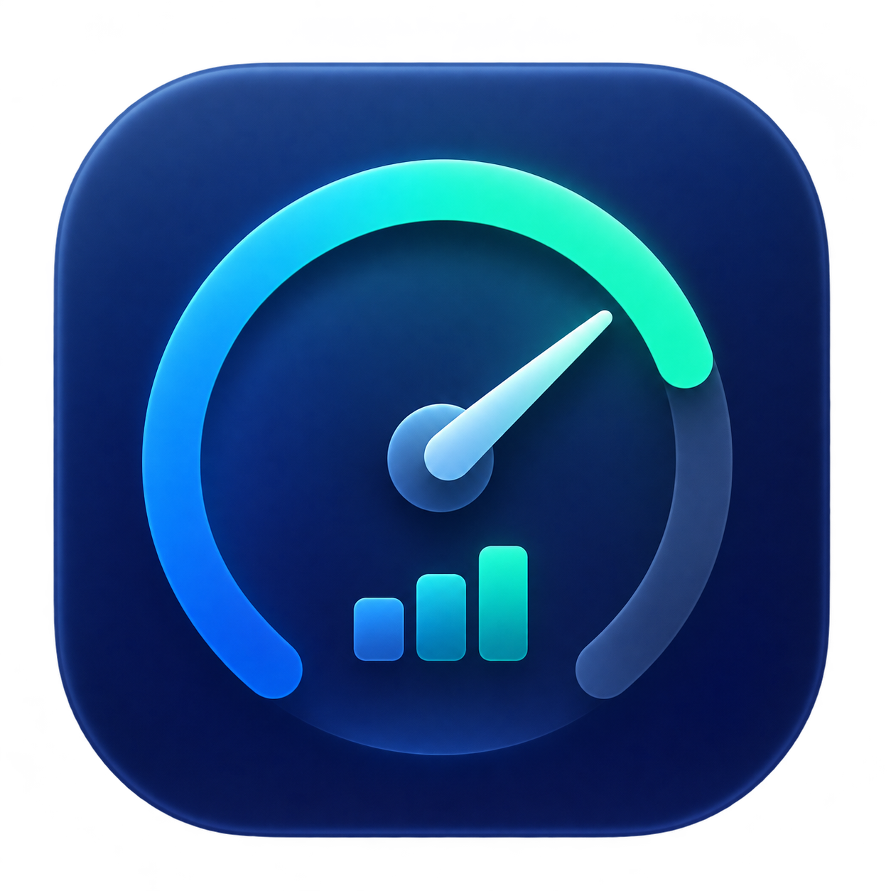

# Subscription Meter

[English](README.en.md) · 简体中文

Subscription Meter 是一款原生 macOS 菜单栏应用，在一个地方查看 AI 服务的订阅用量和预付余额。它在菜单栏轮播服务图标与用量圆环，点击可查看详情、刷新或打开设置。界面目前为中文。



界面截图尚未提供。

## 支持的服务

| 服务 | 显示内容 | 连接方式和限制 |
| --- | --- | --- |
| GitHub Copilot | 月度高级请求或 credits 用量 | 安装 [GitHub CLI](https://cli.github.com/)，运行 `gh auth login`；使用非公开的 Copilot 接口。 |
| ChatGPT / Codex | Codex 返回的用量窗口和重置时间 | 安装 [Codex CLI](https://github.com/openai/codex)，运行 `codex login`；不代表 ChatGPT 所有功能的用量。 |
| Anthropic / Claude | 5 小时及每周用量窗口 | 安装并登录 [Claude Code](https://docs.anthropic.com/en/docs/claude-code/overview)，在设置中启用；依赖非公开接口，尚未使用真实 Claude 订阅端到端验证。 |
| DeepSeek | API 预付余额和币种明细 | 在 `~/.env` 中设置 `DEEPSEEK_API_KEY`；请求官方余额接口。 |
| 硅基流动 | 国内站现金余额，不含代金券 | 在设置中打开登录窗口，登录并进入账单余额页；依赖网站内部接口和页面结构。 |

可在“设置 → 服务”关闭不需要的服务。各服务返回的数据取决于账户和套餐；非公开接口或网页变更可能导致功能失效。

## 下载 nightly 版本

在 [GitHub Releases](https://github.com/greatbody/subscription-meter/releases) 下载最新的 nightly 预发布版本，解压 `Subscription-Meter-macOS-universal.zip`，将 App 移到 `~/Applications` 后打开。该通用版本支持 Intel 和 Apple Silicon，要求 macOS 13 或更高版本。构建为 ad-hoc 签名，未经 Apple 公证；首次打开时 macOS 可能要求在系统设置中允许打开。可在下载目录运行 `shasum -a 256 -c SHA256SUMS.txt` 校验 ZIP。

GitHub Actions 每天北京时间 03:23 构建默认分支，也可手动触发；每次运行生成独立的预发布版本。nightly 可能包含尚未稳定的变更。

## 从源码构建

需要 macOS 13 或更高版本、支持 Swift 5.9 的 Apple 工具链，以及 `sips`、`iconutil` 和 `codesign`。通用二进制同时构建 Intel 和 Apple Silicon 版本。当前构建已在 Intel Mac、Xcode 26.5 / Swift 6.3.2 上验证；单独安装 Command Line Tools 的环境尚未验证。运行 JavaScript 测试还需要 Node.js。

克隆仓库，然后进入项目目录：

```sh
git clone https://github.com/greatbody/subscription-meter.git
cd subscription-meter
scripts/build-app.sh
open 'build/Subscription Meter.app'
```

脚本生成 `build/Subscription Meter.app`，使用本地 ad-hoc 签名，未经 Apple 公证；首次打开时 macOS 可能要求在系统设置中允许打开。首次启动会显示设置窗口，之后从菜单栏图标进入详情与设置。

如需固定安装位置，先从菜单栏退出应用，然后将生成的 App 复制到 `~/Applications`。如果该位置已有同名 App，请先备份或移走旧版本；重新构建不会自动更新已安装的副本。登录时启动可在 App 设置中开启，建议先固定安装位置；如系统要求批准，请在系统登录项设置中确认。

## 连接与隐私

在“设置 → 服务”启用所需服务并完成登录。DeepSeek 从用户主目录的 `~/.env` 读取以下变量，不执行该文件；使用自己的密钥，勿提交到 Git：

```dotenv
DEEPSEEK_API_KEY=your_api_key_here
```

- Copilot 通过本地 `gh` 调用 GitHub；Codex 通过本地 `codex app-server` 获取账户额度。
- Claude 从钥匙串或 `~/.claude/.credentials.json` 读取 Claude Code 凭据，并向 Anthropic 用量接口发出请求；钥匙串可能要求授权。
- DeepSeek 密钥只发送至 `https://api.deepseek.com/user/balance`，遇到重定向时停止请求。
- 硅基流动使用应用自己的持久 WebKit 会话登录 `siliconflow.cn`；不读取其他浏览器的 Cookie。余额功能依赖该站点的账单页面和内部接口。
- 设置保存在本机 UserDefaults 中。报告问题时请移除凭据、Cookie、账户信息和个人数据，勿粘贴完整命令输出或截图中的敏感信息。

## 显示和余额

用量圆环在达到 70% 时变橙色、达到 90% 时变红色；无数据或连接失败时显示灰色，余额服务明确返回不可用时显示红色。部分周、月窗口还会以灰色表示时间进度与用量进度之间的差距。可在设置中调整名称显示、轮播与刷新间隔。

“设置 → 余额”可为 DeepSeek 和硅基流动分别设置大于零的参考容量，余额与该数字比较后以蓝色圆环显示比例；超过参考容量时显示金色满环。不进行币种转换或跨币种汇总。DeepSeek 可按 CNY 和 USD 分别设置低余额阈值；提示显示在详情中，不发送系统通知。

## 开发与验证

项目无第三方 Swift 包依赖。入口和常用目录：

| 路径 | 用途 |
| --- | --- |
| `Sources/main.swift` | App 生命周期、刷新调度和设置窗口 |
| `Sources/UI/`、`Sources/Settings/` | 菜单栏、详情面板和设置 |
| `Sources/Models/`、`Sources/Adapters/` | 数据模型与各服务适配器 |
| `Tests/` | 独立的 Swift 测试及硅基流动页面脚本测试 |
| `scripts/build-app.sh` | 双架构构建、图标生成和 App 打包 |

在仓库根目录执行：

```sh
Tests/run-settings-tests.sh
Tests/run-adapter-tests.sh
Tests/run-balance-ui-tests.sh
node Tests/silicon-dom-tests.js
```

这些检查使用模拟数据，不验证真实账户或服务端兼容性。前三项用 `swiftc` 编译临时测试程序；最后一项需要 Node.js，使用模拟 DOM 和网络响应。`Package.swift` 没有 SwiftPM test target，因此请运行上述脚本，而非依赖 `swift test`。

欢迎提交 issue 或 pull request。提交前请说明问题与复现步骤、修改范围及运行过的检查；适配器变更请提供不含凭据的模拟响应，并注明真实账户验证范围。涉及界面变更时请附脱敏截图。

## 排障和卸载

- 找不到 `gh` 或 `codex`：在终端分别运行 `command -v gh`、`command -v codex` 检查安装，并确认已登录。图形应用不一定继承终端 PATH；应用还会检查 `/opt/homebrew/bin`、`/usr/local/bin`、`/usr/bin` 和 `~/.local/bin`。
- 服务显示错误：检查对应登录状态、套餐权限和网络；非公开接口可能已变化。硅基流动可在设置中重新登录并打开余额页。
- 卸载：先在设置中关闭登录时启动，再退出并删除 App。删除 App 不会自动清除本地偏好、WebKit 会话或 CLI 登录信息。

## 许可证与第三方素材

项目代码按 [MIT License](LICENSE) 发布。服务商图标来源和商标说明见 [NOTICE](Resources/ProviderIcons/NOTICE.md)；第三方品牌素材受各自条款约束，MIT 许可不授予其商标权或额外的素材使用权。
